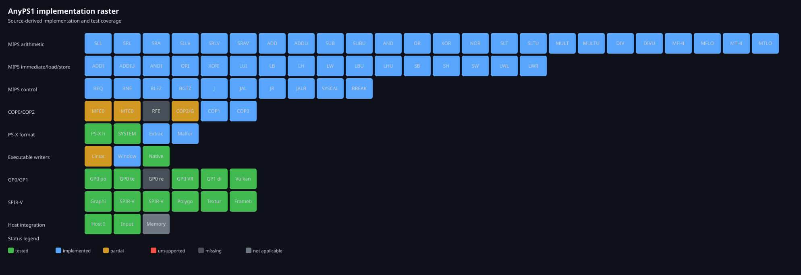

# AnyPS1

## Overview

AnyPS1 converts extracted PlayStation 1 executables into native Linux or Windows
programs. It is a relinker and executable-conversion project, not a PS1 emulator.

## Implementation status

The code-derived implementation overview is available in
[preview/progress.html](preview/progress.html).

<p align="center">
  <a href="preview/progress.html">
    
  </a>
</p>

```sh
cmake --build build --target progress
```

GitHub Actions runs the Linux and Windows CTest suites on pushes and pull requests.
The CI progress job regenerates `preview/progress.{json,html,svg,png}` and rejects
stale preview artifacts in pull requests. Push workflows update and commit preview
artifacts automatically.

## Relinking

### Building the relinker

Clone the repository with all dependencies, or initialize every submodule in an
existing checkout:

```sh
git submodule sync --recursive
git submodule update --init --recursive
```

Configure and build the project with CMake and Ninja:

```sh
cmake -S . -B build -G Ninja -DCMAKE_BUILD_TYPE=Release
cmake --build build --parallel
```

On Windows, open a Visual Studio Developer Command Prompt and run the same
commands. CMake builds `anyps1.exe` for the Windows target and the test binaries
under `build/tests`.

Prepare an extracted disc in this layout:

```text
extracted/
  disc1/
    SYSTEM.CNF
    <boot executable>
    ...other extracted files
  disc2/
    SYSTEM.CNF
    <boot executable>
    ...other extracted files
```

Rearrange the extracted files before relinking. Do not pass a raw CUE or BIN file
directly to the relinker. The [extraction helper](tools/extract_psx_game.py) can
prepare one or more CUE/BIN discs:

```sh
python3 tools/extract_psx_game.py "/path/to/Game.cue"
```

Relink a Linux executable:

```sh
./build/anyps1 --target linux "/path/to/extracted/disc1"
```

The relinker reads `SYSTEM.CNF`, locates the boot PS-X executable, and writes
`game.elf` in the supplied directory.
Linux output is an ELF64, statically linked, non-PIE x86-64 executable with
native `_start`, ELF program/section headers, and no dynamic library dependencies.

Windows conversion emits a PE32+ console artifact with native Windows host
diagnostics:

```sh
./build/anyps1 --target windows "/path/to/extracted/disc1"
```

Native Windows MIPS lowering is still in progress; the generated executable
reports the lowering gap explicitly and exits rather than silently interpreting
or emulating the PS1 executable.

## Current status

- Native Linux ELF lowering is implemented for a tested MIPS subset.
- Partial lowerings produce a valid native ELF and report the unsupported
  instruction/address in terminal diagnostics. Execution exits explicitly
  when it reaches an unsupported operation instead of silently substituting
  emulator behavior.
- Malformed and unsupported executable layouts fail explicitly at relink time.
- PS1 BIOS and emulator fallback behavior are not part of relinking.
- Windows output is planned, not currently supported.
- Generic GP0/GP1 graphics IR and SPIR-V conversion structures are implemented;
  a complete Vulkan runtime and window backend remains under development.

## Testing

```sh
cmake -S . -B build -G Ninja -DCMAKE_BUILD_TYPE=Release
cmake --build build --parallel
ctest --test-dir build --output-on-failure
```

Tests use generated executables materialized from JSON fixtures under
`tests/fixtures/json/`. Generated binaries remain build artifacts.

## Reference conversion validation

The optional `tools/report_relink_gaps.py` helper scans locally extracted
executables found through `SYSTEM.CNF` and reports their first native conversion
gap. It is format-generic and contains no title-specific relinker behavior.

To inventory unsupported instruction families in a boot executable:

```sh
python3 tools/inventory_unsupported_instructions.py \
  "/path/to/executable.ps-exe" \
  --output build/unsupported-instruction-inventory.json
```

## Input mapping

Native Linux and Windows builds can use SDL3 for PS1-style controller input,
including analog sticks and triggers, plus keyboard and mouse mappings.
Create `anyps1-input.ini` beside the relinked executable to override bindings:

```ini
[keyboard]
up=w
down=s
left=a
right=d
cross=j

[controller]
cross=controller:south
left_x=controller_axis:leftx
left_y=controller_axis:lefty

[mouse]
circle=mouse:left
```

## Disclaimer
This project is intended for interoperability, research, preservation, and compatibility purposes. It does not include, distribute, or require copyrighted software, firmware, cryptographic keys, or proprietary libraries. Users are responsible for ensuring that any binaries used with this project are obtained and used in accordance with applicable laws and their respective license terms.

AnyPS1 is an independent project and is not affiliated with, authorized or endorsed by Sony Interactive Entertainment. "PlayStation" and "PS1" are trademarks of Sony Interactive Entertainment Inc.

## License
This project is licensed under the GNU General Public License version 2 only.
